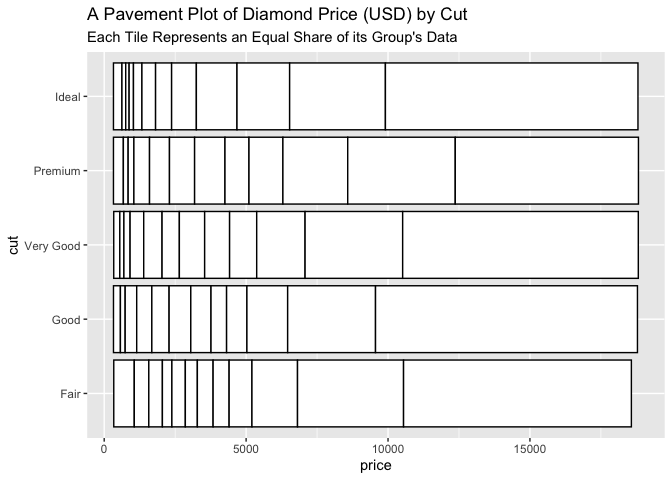

<!-- README.md is generated from README.qmd. Please edit that file -->


# ggpaver (Still in Development)

<!-- badges: start -->

<!-- badges: end -->

The goal of `ggpaver` is to facilitate the use of [pavement
plots](https://planspace.org/20260908-pavement_plots/) in R as a
`ggplot2` extension. Pavement plots present univariate continuous data
as tiles ranging between the minimal and maximal values, with each tile
representing an equal share of the data.

## Installation

You can install the development version of `ggpaver` from
[GitHub](https://github.com/) with:

``` r
# install.packages("pak")
pak::pak("git-dwilliams/ggpaver")
```

## Example

``` r
library(ggplot2)
library(ggpaver)

ggplot(diamonds, aes(x = price, y = cut)) +
  geom_pavement(bins = 16) +
  labs(
    title = "A Pavement Plot of Diamond Price (USD) by Cut",
    subtitle = "Each Tile Represents an Equal Share of its Group's Data"
  )
```



## Original Implementation in Python

Check out the Aaron Schumacher’s original (and much more mature)
[implementation in Python](https://github.com/ajschumacher/pavement/):

``` sh
pip install pavement
```
